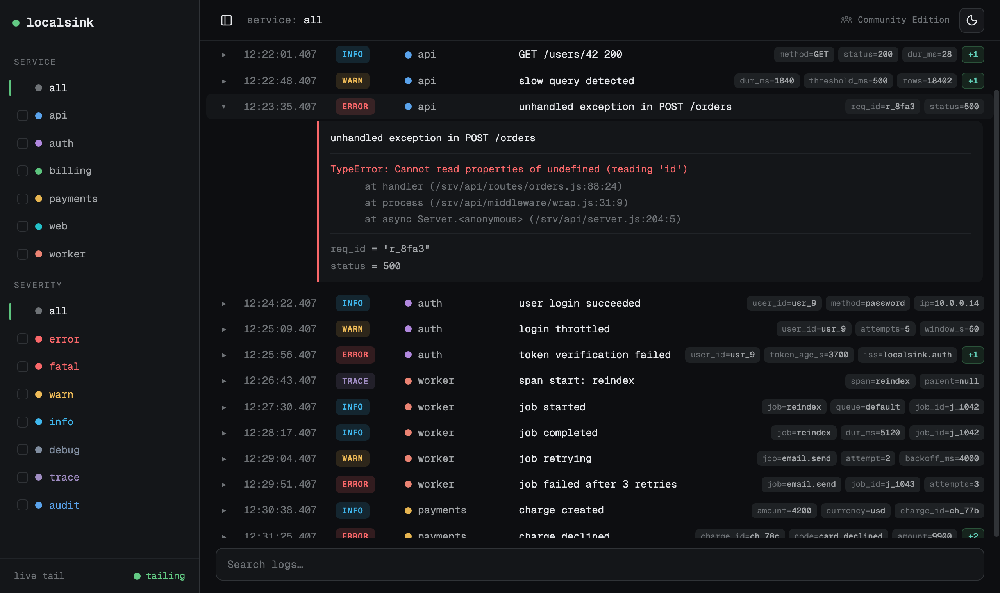

# localsink

**Your logs, readable by you and your agents.**

[Website](https://localsink.io) ·
[Pricing](https://localsink.io/pricing) ·
[Releases](https://github.com/localsink/localsink/releases)

[](https://www.npmjs.com/package/localsink)
[](https://github.com/localsink/localsink/actions/workflows/ci.yml)
[](LICENSE.md)

One local process collects the logs your app routes to it. You get full-text
search, faceted filters and a live tail you can pause. It also runs an MCP
endpoint, so your coding agent can search the same logs instead of asking you
to paste your terminal.



- **Filter and search, don't scroll.** SQLite FTS5 over every message, error
  and attribute, with facets built from your actual data.
- **Agent-ready.** Claude Code, or any MCP client, can query your logs at
  `localhost:3000/mcp` and find the error itself.
- **Zero infrastructure.** One Node process and one SQLite file. No Docker, no
  account, no API key. Your logs never leave your machine.

## Quick start

localsink needs Node.js 24 or later.

**1. Start the server.**

```sh
npx localsink
```

This serves the web UI, the REST API and the MCP endpoint at
<http://localhost:3000>, and keeps logs in `localsink.db` in the current
directory. `Ctrl-C` stops it.

**2. Send it logs.** Pick the integration that matches your logger:

<details open>
<summary><b>pino</b> · <code>npm install @localsink/pino</code></summary>

```ts
import pino from 'pino';

const logger = pino(
  pino.transport({
    target: '@localsink/pino',
    options: { serviceName: 'api' },
  }),
);
```

</details>

<details>
<summary><b>winston</b> · <code>npm install @localsink/winston</code></summary>

```ts
import { createLogger } from 'winston';

import { LocalsinkTransport } from '@localsink/winston';

const logger = createLogger({
  transports: [new LocalsinkTransport({ serviceName: 'api' })],
});
```

</details>

<details>
<summary><b>console</b> · <code>npm install @localsink/console</code></summary>

```ts
import { localsink } from '@localsink/console';

localsink({ serviceName: 'api' });

// console.log still prints to stdout as well
```

</details>

<details>
<summary><b>Anything else</b> · <code>npm install @localsink/sdk</code></summary>

```ts
import { createClient } from '@localsink/sdk';

const client = createClient({ serviceName: 'api' });

await client.log({
  timestamp: Date.now(),
  level: 'info',
  message: 'hello',
});
```

</details>

`serviceName` is the only required option. `url` defaults to
`http://localhost:3000`.

Every transport is safe to leave in your app. Network errors and non-2xx
responses are swallowed, requests time out after three seconds, and nothing
throws or blocks. If localsink isn't running, your app carries on.

## Connect your agent

localsink serves a [Model Context Protocol](https://modelcontextprotocol.io)
endpoint over Streamable HTTP at `http://localhost:3000/mcp`.

With Claude Code:

```sh
claude mcp add --transport http localsink http://localhost:3000/mcp
```

Any other MCP client that supports Streamable HTTP can use the same URL.

The endpoint exposes three tools, which use the same query layer as the UI:

| Tool            | What it does                                                                         |
| --------------- | ------------------------------------------------------------------------------------ |
| `describe_logs` | Lists the services, levels and loggers that exist, the log count and the time range. |
| `search_logs`   | Runs the full filter and full-text search that the UI uses.                          |
| `get_log_by_id` | Returns one log with its attributes, error, stack and metadata.                      |

`describe_logs` tells the model to call it first, so it filters on service and
level names that actually exist instead of guessing them.

## Features

### Search

Search covers the whole store, not just what's on screen. It indexes message
text, error JSON and attributes JSON, including nested values and attribute
keys, so searching `user_id` finds every log that has one.

| Syntax       | Example                                                          |
| ------------ | ---------------------------------------------------------------- |
| prefix       | `err*`                                                           |
| phrase       | `"connection refused"`                                           |
| boolean      | `error AND timeout`, `foo OR bar`, `error NOT debug`             |
| column scope | `message:login`, `error_text:timeout`, `attributes_text:user_id` |

If a query isn't valid FTS5 syntax, localsink runs it again as a literal
phrase instead of returning an error.

Facet filters combine with OR inside a group and AND across groups. Filters
and the search query are kept in the URL, so you can bookmark or share any
view, and each browser tab has its own.

### Live tail

- **Auto-pause, then flush.** When you scroll back through history, new logs
  wait in a `↓ N new` queue instead of moving the page.
- **No gaps, no duplicates.** While you're paused, the tail remembers the last
  log it showed. When you resume, it fills in exactly what you missed.
- **Connection state is always shown:** connected, reconnecting or offline.

### Structured logs stay structured

`trace_id` and `span_id` are indexed columns of their own. Errors keep their
type, message and stack. Levels are free-form, so you can use whatever levels
your logger has.

## Packages

| Package                                            | Use it to                                                                      |
| -------------------------------------------------- | ------------------------------------------------------------------------------ |
| **Run it**                                         |                                                                                |
| [`localsink`](packages/localsink)                  | Run the server and the bundled UI (`npx localsink`), or embed it as a library. |
| **Send logs**                                      |                                                                                |
| [`@localsink/pino`](packages/pino)                 | Send logs from [pino](https://github.com/pinojs/pino).                         |
| [`@localsink/winston`](packages/winston)           | Send logs from [winston](https://github.com/winstonjs/winston).                |
| [`@localsink/console`](packages/console)           | Forward `console.*` calls.                                                     |
| [`@localsink/sdk`](packages/sdk)                   | Send logs from code, or build your own transport on top of it.                 |
| **Build on it**                                    |                                                                                |
| [`@localsink/http`](packages/http)                 | Send a single request with no client, for full control.                        |
| [`@localsink/contract`](packages/contract)         | Validate and type data with the shared Zod wire schemas.                       |
| [`@localsink/test-harness`](packages/test-harness) | Test a custom transport in Vitest against a real server.                       |

## Configuration

```sh
npx localsink --port 4000 --db file:logs/dev.db
```

| Flag           | Env            | Default             |
| -------------- | -------------- | ------------------- |
| `--port`, `-p` | `PORT`         | `3000`              |
| `--host`       | `HOST`         | `127.0.0.1`         |
| `--db`, `-d`   | `DB_FILE_NAME` | `file:localsink.db` |

localsink loads a `.env` file from the working directory if one exists.
Flags take priority over environment variables.

By default localsink listens only on `127.0.0.1`. To reach it from a Docker
container, a devcontainer or another machine, run it with `--host 0.0.0.0`.
Anyone who can reach that address can then read and write your logs.

The [server README](packages/localsink) covers the REST API, programmatic use,
running behind a proxy and browser security.

## Editions

Both editions are the same software, with every feature and the full source
code. The only difference is the license.

- **Community Edition** is for personal and non-commercial use: personal
  projects, hobbyists, students, academic work and open source. You don't need
  an account or a key.
- **Licensed Edition** is for commercial use: internal company tooling, paid
  product work, client deliverables, and work by consultants and freelancers.
  See [localsink.io/pricing](https://localsink.io/pricing).

To activate a license, click **Community Edition** in the UI's top bar and
paste your key. The key is saved for your user, so it covers every project on
that machine. In a container, or anywhere else without a persistent home
directory, set `LOCALSINK_LICENSE_KEY` instead.

Without a key, localsink never contacts us. With one, it validates the key
when you enter it and about once a week afterward. The
[privacy notice](https://localsink.io/privacy) lists exactly what it sends.

localsink is source-available under
[PolyForm Noncommercial 1.0.0](LICENSE.md). For site licenses, purchase
orders or custom terms, email
[licensing@localsink.io](mailto:licensing@localsink.io).

## Development

The repository is a pnpm workspace. It pins Node and pnpm versions in
`package.json`.

```sh
git clone https://github.com/localsink/localsink.git
cd localsink
pnpm install

pnpm build:all        # build every package
pnpm test:all         # unit tests
pnpm integration:all  # integration tests against a real server
pnpm e2e:all          # Playwright end-to-end tests against the built UI
```

To work on the UI, run the server and the Vite dev server side by side:

```sh
pnpm --filter localsink dev       # API and MCP on :3000
pnpm --filter @localsink/web dev  # UI on :5173, proxying /api and /mcp
```

To give the UI something to show, `pnpm --filter localsink seed` loads sample
logs into the dev database. `pnpm --filter localsink emit` streams synthetic
logs to a running server, which is useful for testing the live tail.

## Support

- **Community Edition:**
  [GitHub issues](https://github.com/localsink/localsink/issues)
- **Licensed Edition:** [support@localsink.io](mailto:support@localsink.io)
